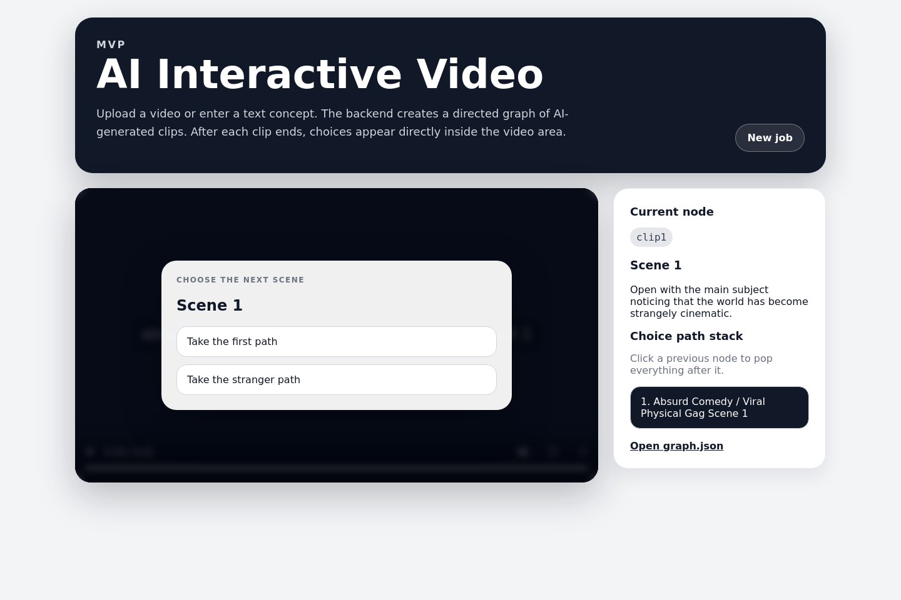

# AI Interactive Video

**Turn a text concept or uploaded video into a branching story that viewers can navigate.**

[中文说明](README.zh-CN.md) · [Configuration](docs/CONFIGURATION.md) · [Architecture/API](docs/ARCHITECTURE.md) · [Publishing](docs/PUBLISH_TO_GITHUB.md) · [MIT license](LICENSE)



A React frontend and FastAPI backend turn a story graph into clips, then show choices inside the player. Viewers can choose a branch, revisit previous scenes, and restore saved jobs.

**Status:** local MVP, version 0.2.0. The screenshot uses local placeholder clips. Live provider output is not included in this release.

## Features

- Text concepts or source-video uploads.
- A directed story graph with branching, converging paths, and optional loops.
- Shared style/character memory carried into segment prompts.
- Configurable Google Veo and fal.ai adapters.
- FFmpeg clip assembly and a local mock provider with audio.
- Job status/history, saved plans, retries that reuse finished segments, and an interactive player.

A fresh checkout defaults to **local demo mode**. Both story planning and video generation stay local in this mode, even if a Gemini key is configured.

## Quick start

Requirements: **Python 3.12**, **Node.js 22.12+**, npm, and **FFmpeg** available on PATH.

Clone or extract the source. From the repository root:

```bash
cd backend
python3 -m venv .venv
source .venv/bin/activate
python -m pip install -r requirements.txt
cp .env.example .env
python -m uvicorn app.main:app --host 127.0.0.1 --port 8000 --reload
```

In a second terminal, from the repository root:

```bash
cd frontend
npm ci
npm run dev
```

Open **http://localhost:5173**. Keep **Local demo** selected, enter a text concept, and create a job. FFmpeg generates placeholder clips; choices appear after a clip ends.

Backend health: **http://localhost:8000/api/health**. Interactive API docs: **http://localhost:8000/docs**.

On Windows, activate with `.venv\Scripts\Activate.ps1` and copy with `Copy-Item .env.example .env`. The remaining commands are the same.

After installing both dependency sets on macOS/Linux, `./scripts/start-demo.sh` starts both servers. Stop them with Ctrl+C.

## Live AI providers

Edit only your local `backend/.env` and restart the backend.

| Mode | Credentials | Behavior |
| --- | --- | --- |
| `mock` | None | Local placeholder graph and videos |
| `veo_lite` / `veo_fast` / `veo_standard` | `GEMINI_API_KEY` | Gemini planning; Veo receives text prompts |
| `fal` | `FAL_KEY`; Gemini key optional for AI planning | fal adapter; an uploaded reference can guide the first segment |

Select the corresponding provider in the UI. If required credentials are absent, the API returns a clear error before queuing generation. Model IDs are configurable examples inherited from the prototype; verify current availability in your provider account. Live APIs incur provider charges and are not used by CI.

See [configuration](docs/CONFIGURATION.md) for IDs, durations, resolution, references, retries, and frontend URLs. Provider documentation: [Google](https://ai.google.dev/gemini-api/docs/video), [fal](https://docs.fal.ai/).

## Duration and request count

The backend rounds a requested node length up to whole segments. With 8-second segments, a 15-second request becomes about 16 seconds; a 60-second request becomes about 64 seconds.

Video-generation calls per job are approximately:

`node_count × ceil(requested_clip_seconds / segment_seconds)`

At the default 5 nodes and 8-second segments, the two options require 10 or 40 segments, before provider retries. The app creates all node clips, including unvisited branches.

## Try the API

```bash
curl -X POST http://localhost:8000/api/jobs   -F input_mode=text   -F input_text="A robot discovers a secret garden"   -F video_provider=mock   -F clip_length_seconds=15
```

Use the returned job ID with `GET /api/jobs/{job_id}` and `GET /api/jobs/{job_id}/graph`. See the [API guide](docs/ARCHITECTURE.md).

## Development

```bash
# From the repository root, using the backend virtual environment
backend/.venv/bin/python -m pip install -r backend/requirements-dev.txt
backend/.venv/bin/python -m pytest -q
npm --prefix frontend ci
npm --prefix frontend run build
python3 scripts/check_release.py
```

Tests include an actual local FFmpeg job, graph persistence, credential validation, and file-path containment. GitHub Actions runs backend checks and frontend builds without provider keys. See [validation](docs/VALIDATION.md), [contributing](CONTRIBUTING.md), and [changelog](CHANGELOG.md).

## Current limits

This is a local single-user app. Jobs use in-process FastAPI background tasks and filesystem storage, so in-flight work does not automatically resume after a backend restart. There is no login, job ownership enforcement, or durable worker queue. Media endpoints expose local job assets to anyone who can reach the server.

The local demo uses fixed fallback story beats and placeholder visuals. Live clips are generated from prompts independently, so character continuity is not guaranteed. Public hosting and untrusted uploads need additional deployment controls.

Future work: durable workers; graph-aware continuity; stronger plan validation; authenticated sharing.

Original project by **Ziyang Ye**. Source is [MIT licensed](LICENSE); see [NOTICE](NOTICE.md) for dependency and external-service terms.
